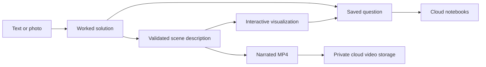

# Chalk

<p align="center"></p>

**An interactive notebook for understanding physics, chemistry, and mathematics.**

Submit a question as text or a photo. Chalk keeps the original problem alongside a worked solution, then builds an interactive visual explanation. Explore the variables, follow the derivation, and turn the explanation into a narrated video within the same notebook.

**[Open Chalk](https://chalk.anshulraman.com)**

## Explore a question

1. Create a notebook and add a **New question**. Type the problem, upload a photo, or capture one with your camera.
2. Read the saved problem and written solution in **Problem**, with equations displayed in mathematical notation.
3. Open **Derivation** to follow the explanation and highlight relevant parts of the simulation.
4. Use **Variables** to adjust sliders or enter exact values. The scene and calculated answers update together.
5. Play, pause, scrub, or change the playback speed. Orbit and zoom the scene to inspect it.
6. Select **Explanation** to generate or watch a narrated MP4. Saved video versions remain available for playback and download.

## What it supports

| Area | Experience |
| --- | --- |
| Physics | Animated apparatus, trajectories, force and velocity vectors, and calculated quantities. |
| Chemistry | Schematic models, relationships, and reaction explanations with explicit assumptions. |
| Mathematics | Graphs, symbolic reasoning, and illustrative visualizations accompanying a written solution. |
| Conceptual questions | Written reasoning and visual demonstrations, even when the answer is not a single number. |

Illustrative parameters are distinguished from values supplied in the question. A visual example helps explain a mathematical proof; it does not replace the proof. If a question lacks information needed for a unique answer, the written response explains what is missing.

Ten built-in examples cover projectile motion, a rough incline, an Atwood pulley, a circular orbit, elastic collision, ideal pipe flow, a travelling wave, damped springs, a source-free RLC circuit, and linear fluid drag. These examples can be explored without a model request.

## Notebooks and saved work

- Sign in to reopen notebooks and questions on another browser or device.
- Create and rename notebooks and choose questions from the notebook tree. The scene picker follows the active notebook.
- Rename individual questions or remove them from the active list. Removed questions can be restored with their saved content.
- Keep submitted text or photos, extracted problem text, worked solutions, parameter values, simulation versions, and video references together.
- Regenerating a simulation preserves earlier versions so they can be selected again.
- Share a link to the selected scene and its parameter values.

Supabase stores account data with ownership policies. Explanation MP4s live in a private Supabase Storage bucket and are served through authenticated routes with temporary playback links.

Existing videos rendered on the local server are uploaded to cloud storage under their original IDs when the signed-in local app opens. Completed local renders upload automatically, with retries on later local visits. Uploading an existing MP4 does not re-render it or remove the local file. Both the local and deployed app can play cloud videos.

## How it works



The solution and visualization are separate stages. Model-generated scenes are structured data containing objects, equations, and timeline steps, rather than executable rendering code. Chalk parses expressions, evaluates answers, and checks the scene before displaying it.

On Vercel, generation runs through durable Workflow jobs. Video rendering runs in a Vercel Sandbox with Python, Manim, FFmpeg, TeX, and narration tools. The completed MP4 is uploaded to Supabase Storage. The browser checks the saved job status, so refreshing or signing out does not cancel a hosted rendering job.

A prepared Sandbox snapshot keeps the rendering dependencies installed. Set `CHALK_VIDEO_SNAPSHOT_ID` to that snapshot so new jobs skip package installation. Each video still gets an isolated sandbox; only the clean rendering environment is reused, never another question's files or upload credentials. Without a configured snapshot, a job must install its dependencies first.

Local development can use Gemini, OpenCode, or Ollama. OpenCode and Ollama run on the local host; the deployed Vercel generation workflow uses Gemini and does not depend on a laptop's loopback server.

## Technology

| Layer | Tools |
| --- | --- |
| Application | Next.js App Router, React, TypeScript |
| Interactive scenes | Three.js, React Three Fiber, drei |
| Equations and calculations | KaTeX, mathjs, Zod validation |
| Accounts and persistence | Supabase Auth, Postgres, private Storage |
| Hosted execution | Vercel, Workflow, Sandbox |
| Explanation videos | Python, Manim, FFmpeg, TeX, Windows speech voices or Linux eSpeak |
| Model backends | Gemini for hosted generation; OpenCode or Ollama for local development |

## Run locally

Use Node.js 24 and npm. Install dependencies and copy the example configuration:

```sh
npm install
cp .env.example .env.local
```

On PowerShell, `Copy-Item .env.example .env.local` also works.

Configure the same Supabase project used by the deployed app to share account data and cloud videos:

```dotenv
NEXT_PUBLIC_SUPABASE_URL=https://YOUR_PROJECT.supabase.co
NEXT_PUBLIC_SUPABASE_PUBLISHABLE_KEY=YOUR_PUBLISHABLE_KEY
```

For the hosted model backend locally:

```dotenv
CHALK_SOLVER=gemini
GEMINI_API_KEY=YOUR_SERVER_SIDE_KEY
```

Then run `npm run dev` and open `http://127.0.0.1:3000`. Use `npm run dev:lan` to make the app accessible to devices on the same network.

### Other local model backends

**OpenCode:** sign in through OpenCode and configure the provider and model variables in `.env.local`. `npm run dev:opencode` starts or reuses the local bridge on port 4098 and starts Chalk. Keep the bridge bound to loopback.

**Ollama:** install and download the configured model, then use `npm run dev:local`. Model and server settings are listed in `.env.example`. For a model hosted on a second computer, see [the local model setup](MAC_MODEL_SETUP.md).

### Optional local video rendering

Install Python, FFmpeg, a TeX distribution with `latex` and `dvisvgm`, and the native dependencies required by Manim. Then run:

```sh
npm run setup:video
```

Local rendering uses `.chalk-work/video-venv` and writes jobs into `.chalk-work/videos`. Windows speech voices provide narration on Windows; Linux uses eSpeak when available. Hosted generation provides its rendering tools inside Vercel Sandbox, so users of the deployed app do not need them installed.

## Deploy

1. Connect the repository to a Vercel project.
2. Apply the SQL files in `supabase/migrations` in chronological order.
3. Set `NEXT_PUBLIC_SUPABASE_URL`, `NEXT_PUBLIC_SUPABASE_PUBLISHABLE_KEY`, `CHALK_SOLVER=gemini`, and `GEMINI_API_KEY` in Vercel. Optional Gemini model overrides are listed in `.env.example`.
4. Configure Supabase Auth's site URL and allowed redirect URLs for the deployed domain and local development URLs.
5. Deploy. The Next.js configuration enables Workflow and includes the fixed video-rendering scripts and logo needed by Sandbox jobs.

For faster video startup, run `scripts/setup-cloud-video.py` once inside a clean Vercel Sandbox, snapshot the prepared environment, and configure its ID as `CHALK_VIDEO_SNAPSHOT_ID`. Rebuild that snapshot when changing renderer dependencies. The application sends the current rendering scripts separately, so ordinary script updates do not require reinstalling the dependencies.

Vercel Sandbox access uses the deployment's Vercel identity. Supabase requests use the authenticated user's session and ownership policies; the video pipeline does not require a Supabase service-role key.

With the Vercel CLI installed, a linked project can be deployed with:

```sh
vercel deploy --prod
```

Provider credentials belong only in server-side environment variables. Do not put them in `NEXT_PUBLIC_` variables or commit `.env.local`.

## Checks and model boundaries

```sh
npm test
npm run typecheck
npm run build
```

Tests cover expression safety, scene references, numerical agreement, parameter ranges, physics examples, account isolation, cloud persistence, saved versions, and video uploads.

The expression validator rejects assignments, arbitrary property access, unsupported functions, and nonfinite results. Scene checks sample the timeline and parameter ranges, check answer agreement, and detect ineffective controls. The renderer uses fixed Python templates with validated scene data.

These checks help catch structural and numerical errors; they do not prove that a generated scientific model is correct. Read each explanation with its assumptions. The built-in examples use specific idealized models, and generated visualizations may be schematic. Rendering and model latency depend on the problem and available resources.
